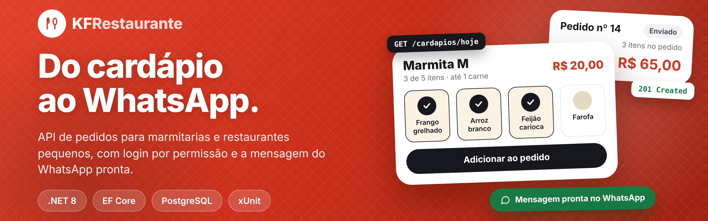
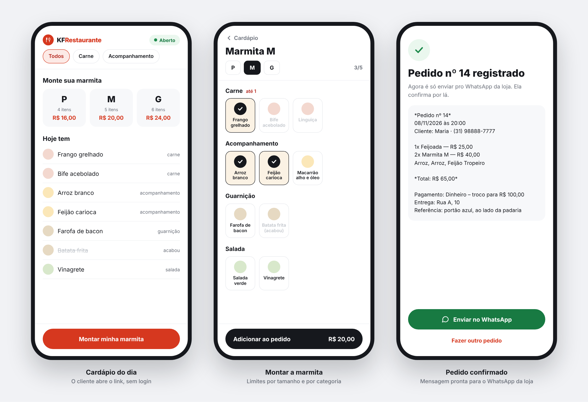
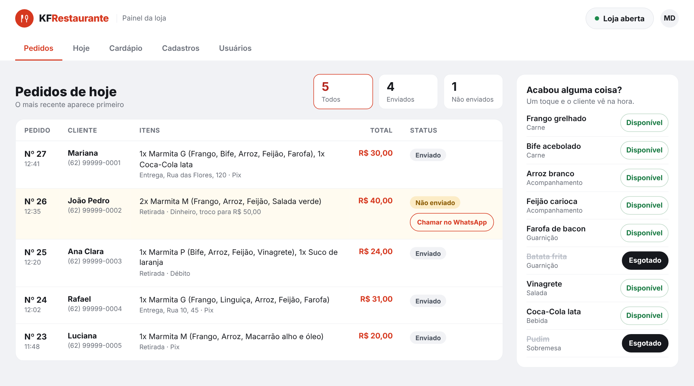
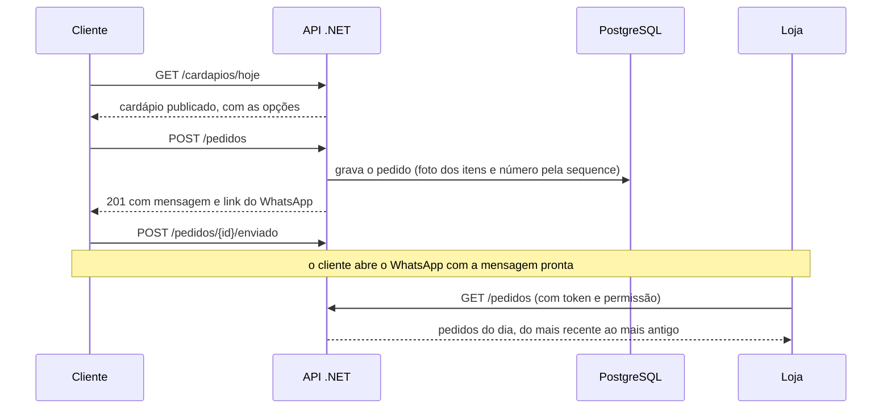

<p align="center">
  
</p>

# 🍱 KF Restaurante: API

Oi, eu sou o Karlos e esta é a API do **KF Restaurante**, um sistema de pedidos para marmitarias e restaurantes pequenos. O dono cadastra as opções, monta e publica o cardápio do dia e define como cada tamanho de marmita pode ser montado. O cliente faz o pedido escolhendo itens avulsos (uma Coca, uma porção de feijoada) ou marmitas montadas (tamanho mais componentes), e o pedido termina no **WhatsApp da loja**: a API devolve a mensagem pronta e um link `wa.me`.

Projeto de estudo e portfólio: o foco está menos na quantidade de funcionalidades e mais em **modelar bem o domínio** e tomar decisões conscientes de persistência e de API.

> 🤖 **Transparência:** a base do backend eu escrevi à mão, aprendendo .NET; o resto do backend e o frontend foram feitos com IA, seguindo **Spec-Driven Development**, o método que pratiquei no desafio Halloween 2026 do balta.io. Os detalhes estão em [Sobre este projeto](#-sobre-este-projeto-e-como-foi-construído).

<p>
  
  
  
  
  
  
  
</p>

---

## 📸 A interface que usa esta API

O frontend em React fica em outro repositório: [kf-restaurante-frontend](https://github.com/karlosdevcs/kf-restaurante-frontend).

### O cliente pede pelo celular, sem login

<p align="center">
  
</p>

### A loja acompanha os pedidos num painel com login por permissão

<p align="center">
  
</p>

> As telas acima usam dados de exemplo.

---

## ✨ O que a API faz

| Cliente (sem login) | Loja (com login e permissões) |
|---|---|
| Consulta o cardápio de hoje, os tamanhos com seus limites e se a loja está aberta | Lista os pedidos do dia, com itens, e filtra por status |
| Cria o pedido (avulso e marmita) e recebe a **mensagem e o link do WhatsApp prontos** | Marca o que esgotou |
| Avisa à API que tocou em "Enviar no WhatsApp" | Abre e fecha a loja e define o WhatsApp que recebe os pedidos |
| | Cria, edita (enquanto é rascunho), publica e fecha o cardápio do dia |
| | Cadastra opções, tamanhos e limites por categoria |
| | Gerencia usuários e as permissões de cada um |

---

## 🎯 Sobre este projeto e como foi construído

O KF Restaurante é um **projeto de estudo**: eu queria aprender .NET e backend de verdade, e ele virou também o meu portfólio. Por isso quero deixar claro o que eu escrevi e o que foi feito com ajuda de IA.

| Parte | Como foi feita | O que tem nela |
|---|---|---|
| 🛠️ **Base do backend** | **À mão**, aprendendo cada peça. Estudei com um tutor de IA configurado para **não me dar código pronto**: eu escrevia, errava e ele apontava o porquê. Tudo o que está ao lado eu digitei e sei explicar | • **LINQ:** `Any`, `Find`, `Select` e lambdas. O `Select` devolve um `IQueryable` e a consulta só vai ao banco quando alguém percorre o resultado (execução adiada). O `Any` vira um `SELECT EXISTS`, que li no log do EF<br>• **Valores nulos:** `string?`, o `!` e a análise de fluxo do compilador, até zerar os warnings do projeto<br>• **Orientação a objetos:** construtores que validam, `private set`, `static`, interface como filtro de visão (`IPedivel`) e `record` para DTOs<br>• **Domínio rico:** `Opcao`, `TamanhoMarmita`, `Marmita`, `CardapioDoDia`, `Pedido`, `ItemDoPedido` e `Restaurante`, com a regra de negócio na classe e não no endpoint<br>• **Pedido como raiz do agregado:** só ele cria itens e aplica as regras do pedido<br>• **Foto, não referência:** o item do pedido guarda o nome e o preço do momento da compra, porque pedido é documento histórico. Mudar o preço amanhã não reescreve o total de ontem<br>• **EF Core com PostgreSQL:** chaves primárias, construtores privados, muitos-para-muitos com tabela de junção, índice único e um laço sobre o modelo para deixar tabelas e colunas em minúsculo<br>• **Ciclo objeto, banco, objeto:** o `Add` anota no change tracker, o `SaveChanges` executa dentro de uma transação (vi o rollback acontecer) e o `RETURNING id` devolve o id gerado<br>• **Migrations:** mudança de esquema só por migration, nunca `ALTER TABLE` na mão, e leitura antes de aplicar (a leitura pegou um erro de chave estrangeira)<br>• **Regra no banco e no endpoint:** índice único mais `Any`, para dar uma mensagem clara no caso comum<br>• **Web API:** injeção de dependência (entendendo por que um `new` no endpoint vazava conexões), user-secrets, status codes (`200`, `201` com `Location`, `404`, `409`), DTOs de entrada e saída com o método `De`, enums como texto e Swagger<br>• **No dia a dia:** stack trace lido de trás para a frente, debug e git entre duas máquinas, com commits `tipo: descrição` |
| 🤖 **Backend ampliado** | **Spec-Driven Development**, com o Claude Code. Eu escolhi o que construir, e a IA implementou por fases, com a spec antes do código, uma fase por vez e um commit por fase | • Cardápio do dia, com rascunho, publicação e fechamento<br>• Pedidos com a mensagem e o link do WhatsApp gerados pela API<br>• Status do pedido (gerado e enviado)<br>• Login com JWT e permissões por usuário<br>• Erros centralizados em `ProblemDetails`<br>• Testes de domínio e de segurança das rotas (xUnit) |
| 🤖 **Frontend** ([outro repositório](https://github.com/karlosdevcs/kf-restaurante-frontend)) | **Spec-Driven Development**, com o Claude Code. Defini o design e a spec com apoio de IA (protótipo clicável, tokens, medidas, regras, critérios de aceite e o contrato lido do código deste backend). A execução foi em 11 fases, com cada divergência, lacuna e decisão registrada em um `PROGRESSO.md` | • Área do cliente no celular e no computador, sem login<br>• Login, sessão e abas por permissão<br>• Painel da loja: pedidos, hoje, cardápio, cadastros e usuários<br>• Mais de 360 testes (Vitest, Testing Library e MSW)<br>• Verificado contra esta API, o que mostrou um bug de CSS que os testes não pegavam |
| 📚 **De onde vem o método** | O **desafio Halloween 2026 do [balta.io](https://balta.io)**, em que pratiquei Spec-Driven Development de ponta a ponta, em três projetos | • **[Desafio 1: gerador de senhas](https://github.com/karlosdevcs/balta-desafio-halloween-2026-spec-driven-01):** escrevi à mão a constituição, a spec, o plano e as tarefas, e a IA implementou. Testes unitários e de integração<br>• **[Desafio 2: encurtador de URLs](https://github.com/karlosdevcs/balta-desafio-halloween-2026-spec-driven-02):** cada tarefa rastreada até o requisito que a originou, e contradições entre spec e plano achadas antes de codar. 114 testes<br>• **[Desafio 3: encurtador com SpecKit](https://github.com/karlosdevcs/balta-desafio-halloween-2026-spec-driven-03):** fluxo completo do SpecKit, com TDD. 58 testes e 93% de cobertura de linhas |

Não escrevi à mão a parte ampliada do backend nem o frontend, e não vou fingir que escrevi. O que eu trago é o jeito de trabalhar com a IA como ferramenta de engenharia: a spec vem antes do código, o trabalho é dividido em tarefas pequenas, e o resultado é auditado.

---

## 🔄 Como um pedido acontece



---

## 🚀 Como rodar

**Pré-requisitos:** .NET 8 SDK, PostgreSQL e a ferramenta do EF Core (`dotnet tool install --global dotnet-ef --version 8.0.11`).

1. **Connection string.** A senha do banco não fica no repositório: o `appsettings.json` tem só a parte pública. Guarde a connection string completa no user-secrets:

   ```bash
   dotnet user-secrets set "ConnectionStrings:KFRestaurante" "Host=localhost;Port=5432;Database=kfrestaurante;Username=postgres;Password=SUA_SENHA"
   ```

2. **Segredos de autenticação.** A API **não sobe** sem a chave de assinatura do login (JWT). Gere um texto aleatório longo (32 caracteres ou mais) e guarde no user-secrets, junto com os dados do primeiro superuser, que é criado automaticamente na primeira execução:

   ```bash
   dotnet user-secrets set "Jwt:Chave" "<texto aleatório com 32+ caracteres>"
   dotnet user-secrets set "Seed:Superuser:Nome" "Seu Nome"
   dotnet user-secrets set "Seed:Superuser:Email" "voce@exemplo.com"
   dotnet user-secrets set "Seed:Superuser:Senha" "uma senha com 8+ caracteres"
   ```

3. **Banco.** Cria o banco e aplica todas as migrations:

   ```bash
   dotnet ef database update
   ```

4. **API.** O perfil `KFRestaurante` sobe em ambiente Development, que é onde o user-secrets é carregado:

   ```bash
   dotnet run --launch-profile KFRestaurante
   ```

   Swagger: http://localhost:5000/swagger. Para testar rotas protegidas por lá, faça `POST /auth/login`, copie o `token` da resposta e cole no botão **Authorize**.

   Se o front rodar em outro endereço, inclua-o em `Cors:OrigensPermitidas` no `appsettings.json`. Já vêm liberadas as portas mais comuns de desenvolvimento (5173, 3000 e 5500).

5. **Testes:**

   ```bash
   dotnet test KFRestaurante.sln
   ```

### Fluxo mínimo para fazer um pedido

1. `POST /auth/login` com o superuser criado no passo 2. Use o `token` devolvido no cabeçalho `Authorization: Bearer <token>` das próximas chamadas da loja.
2. `POST /opcoes` e `POST /tamanhos`: cadastra o que é vendido.
3. `POST /cardapios` com os ids das opções e depois `POST /cardapios/{id}/publicar`.
4. `PUT /restaurante/whatsapp` e `POST /restaurante/abrir`. O restaurante só abre com o WhatsApp cadastrado.
5. `POST /pedidos` (aberto, **sem login**: é o que o cliente usa): a resposta traz `mensagemWhatsApp` e `linkWhatsApp`.

---

## 🧭 Endpoints

A coluna **Acesso** diz o que a rota exige: **aberta** (cliente, sem login), **logado** (qualquer usuário ativo), **gerenciar usuários** (dono ou superuser) ou uma **permissão** específica (ver "Login e permissões por usuário" em Decisões de projeto).

| Recurso | Rota | Acesso | O que faz |
|---|---|---|---|
| **Login** | `POST /auth/login` | aberta | E-mail e senha; devolve o token e o usuário |
| | `GET /auth/eu` | logado | Quem sou eu e o que posso fazer |
| | `POST /auth/trocar-senha` | logado | A pessoa troca a própria senha |
| **Usuários** | `GET /usuarios` · `GET /usuarios/{id}` | gerenciar usuários | Lista quem você gerencia (e você mesmo) |
| | `POST /usuarios` | gerenciar usuários | Cria usuário; papel e permissões limitados pela hierarquia |
| | `PUT /usuarios/{id}` | gerenciar usuários | Edita nome e **substitui** as permissões |
| | `POST /usuarios/{id}/desativar` · `/ativar` | gerenciar usuários | Corta / devolve o acesso na hora |
| | `PUT /usuarios/{id}/senha` | gerenciar usuários | Redefine a senha de quem você gerencia |
| **Opções** | `GET /opcoes` · `GET /opcoes/{id}` | logado | Lista / busca |
| | `POST /opcoes` · `PUT /opcoes/{id}` | `GerenciarCadastros` | Cadastra / edita nome, categoria e preço opcional |
| | `PATCH /opcoes/{id}/esgotado` | `EsgotarOpcoes` | Marca ou desmarca como esgotada |
| **Tamanhos** | `GET /tamanhos` · `GET /tamanhos/{id}` | aberta | Lista / busca, com os limites por categoria |
| | `POST /tamanhos` · `PUT /tamanhos/{id}` | `GerenciarCadastros` | Cadastra / edita nome, preço e limite total de componentes |
| | `PUT /tamanhos/{id}/limites` | `GerenciarCadastros` | Define os limites por categoria (ex.: até 2 carnes) |
| **Cardápio do dia** | `GET /cardapios/hoje` | aberta | **Ponto de entrada do cliente:** o cardápio de hoje, se já publicado (rascunho o cliente não vê) |
| | `GET /cardapios/hoje/painel` | `GerenciarCardapio` | O cardápio de hoje em **qualquer** situação, inclusive rascunho |
| | `POST /cardapios` · `GET /cardapios/{id}` | `GerenciarCardapio` | Cria o cardápio de hoje (sempre como rascunho) a partir de ids de opções / busca |
| | `PUT /cardapios/{id}/opcoes` | `GerenciarCardapio` | **Substitui** as opções de um cardápio em **rascunho** (publicado ou fechado: 400) |
| | `POST /cardapios/{id}/publicar` · `/fechar` | `GerenciarCardapio` | Abre / encerra as vendas (publicar de novo reabre) |
| **Restaurante** | `GET /restaurante` | aberta | Estado global: fechado bloqueia pedidos |
| | `POST /restaurante/abrir` · `/fechar` | `AbrirFecharLoja` | Abre / fecha a loja |
| | `PUT /restaurante/whatsapp` | `AlterarWhatsApp` | Número da loja, para onde o pedido é enviado |
| **Pedidos** | `POST /pedidos` | aberta | Cria, com a mensagem e o link do WhatsApp na resposta |
| | `POST /pedidos/{id}/enviado` | aberta | O front chama quando o cliente toca em "Enviar no WhatsApp" |
| | `GET /pedidos?data=&status=` | `VerPedidos` | Painel da loja: pedidos de um dia (hoje por padrão), do mais recente ao mais antigo, **com os itens** (sem a mensagem do WhatsApp) |
| | `GET /pedidos/{id}` | `VerPedidos` | Pedido completo, com a mensagem e o link do WhatsApp |

Exemplo de pedido com um item avulso e uma marmita:

```json
POST /pedidos
{
  "nomeCliente": "Maria",
  "telefone": "(31) 98888-7777",
  "cardapioId": 3,
  "formaDePagamento": "Dinheiro",
  "trocoPara": 100,
  "tipoDeEntrega": "Entrega",
  "endereco": "Rua A, 10",
  "referencia": "portão azul, ao lado da padaria",
  "observacao": "sem cebola na feijoada",
  "itens": [
    { "opcaoId": 7, "quantidade": 1 },
    { "tamanhoId": 2, "componentesIds": [1, 1, 11], "quantidade": 2 }
  ]
}
```

A mensagem que chega à loja (campo `mensagemWhatsApp` da resposta):

```
*Pedido nº 14*
08/11/2026 às 20:00
Cliente: Maria · (31) 98888-7777

1x Feijoada — R$ 25,00
2x Marmita M — R$ 40,00
   Arroz, Arroz, Feijão Tropeiro

*Total: R$ 65,00*

Pagamento: Dinheiro – troco para R$ 100,00
Entrega: Rua A, 10
Referência: portão azul, ao lado da padaria

Obs.: sem cebola na feijoada
```

Todo erro volta no formato padrão **ProblemDetails** (RFC 9110), com a mensagem dizendo o que estava errado e com qual valor. Até 401, 403 e 404 sem corpo saem nesse formato, com `detail` em português:

```json
{ "status": 400, "title": "Regra de negócio violada.", "detail": "A Marmita M aceita no máximo 1 de Carne. Porção dupla conta como 2." }
```

---

## 🧠 Decisões de projeto

### O pedido chega completo no WhatsApp, sem perguntas

O critério para cada campo do pedido foi: *"se faltar, a loja vai precisar perguntar?"*. Por isso o pedido tem nome do cliente, troco (e "sem troco" escrito por extenso quando não precisa), referência do endereço e observação livre.

O envio usa o link **click-to-chat (`wa.me`)**, e não a API oficial da Meta. A API monta o texto, e o WhatsApp do próprio cliente abre com a mensagem pronta. Não tem custo nem aprovação, e a loja recebe do número do cliente, podendo responder direto. Bibliotecas não oficiais foram descartadas porque violam os termos do WhatsApp e podem levar ao banimento do número da loja. A contrapartida é que o sistema não confirma o envio: o relatório conta pedidos **gerados**.

A montagem da mensagem fica fora do domínio (`Servicos/MensagemWhatsApp`): é formato de saída, não regra de negócio. Ela usa valores em formato brasileiro e horário de Brasília em qualquer servidor, e o restaurante só abre com o número da loja cadastrado.

### O pedido guarda uma foto, não uma referência

O `ItemDoPedido` copia **nome, preço unitário e componentes** no momento da compra, em vez de apontar para a opção.

**Por quê:** o dono muda preços e cardápio o tempo todo. Se o item apontasse para a opção, aumentar o preço da Coca amanhã mudaria o total dos pedidos de ontem, e o relatório mentiria sobre o passado. A foto inclui os componentes da marmita (ex.: `"Arroz, Arroz, Feijoada"`), porque é isso que a cozinha precisa saber, e a marmita em si não é persistida: ela existe só enquanto o pedido é montado.

### Pedido é a raiz do agregado

Só o `Pedido` cria itens (`AdicionarItem`), e é ele quem aplica as regras: restaurante aberto, cardápio publicado, opção no cardápio, opção não esgotada, marmita não vazia, endereço na entrega. No banco, o item **não existe sem o pedido** (chave estrangeira obrigatória, apagado em cascata junto com ele).

### Regras no domínio, não no endpoint

As entidades não têm `set` público: mudar estado só por método (`Publicar()`, `Fechar()`, `SubstituirOpcoes()`, `AlterarEsgotado()`, `DefinirLimites()`). Assim não existe caminho para, por exemplo, publicar um cardápio vazio escrevendo `cardapio.Situacao = Publicado`, nem para trocar as opções de um cardápio que o cliente já está vendo.

Os endpoints fazem só três coisas, nesta ordem: validam o formato do request, buscam no banco o que já existe (nunca criam `Opcao` ou `TamanhoMarmita` a partir do JSON) e entregam ao domínio. A persistência é configurada por Fluent API no `KFContext`, sem atributos de banco no domínio.

### Erros centralizados com ProblemDetails

Violação de regra lança `DominioException`. Um `IExceptionHandler` global traduz:

| Exceção | Status |
|---|---|
| `DominioException` | 400, com a mensagem da regra |
| JSON malformado ou com tipo errado | 400 |
| Violação de índice único no Postgres (`23505`) | 409 |
| Qualquer outra | 500, sem stack trace no corpo (o detalhe vai só para o log) |

Os endpoints não têm `try/catch`.

### Unicidade nas duas pontas

Nomes de opção e de tamanho e a data do cardápio são únicos **no banco** (índice único) **e no endpoint** (`AnyAsync` antes de gravar). O `Any` dá uma mensagem clara no caso comum. O índice garante a regra quando dois requests chegam ao mesmo tempo: num teste com 10 requests simultâneos, 4 foram barrados pelo `Any` e 5 pelo índice, sem nenhum duplicado e sem nenhum 500.

### Número do pedido gerado pelo banco

O número sai de uma *sequence* do PostgreSQL, não de "maior número + 1" no código, que daria o mesmo número a dois pedidos simultâneos.

### O dono configura a marmita: limites são dados, não código

Cada tamanho tem um limite total de componentes e, opcionalmente, limites por categoria (*até 2 carnes, até 1 salada*), editáveis pela API. Categoria sem limite fica livre dentro do total. **Porção dupla conta como 2** no limite da categoria. A mudança vale dali em diante, e os pedidos antigos não mudam, por causa da foto.

### Preço opcional: quem vende avulso e quem é só componente

`Preco` nulo significa que a opção só entra em marmita (o arroz). Com preço, ela pode ser vendida sozinha e também entrar em marmita, onde vale o preço do tamanho. Bebida e sobremesa não entram em marmita e, por isso, exigem preço.

### Apagar não pode destruir histórico

As chaves estrangeiras usam `Restrict` onde apagar levaria junto dados que importam: apagar um cardápio não apaga os pedidos do dia, e apagar um tamanho não apaga marmitas. O banco recusa a exclusão.

### Detalhes que evitam bugs silenciosos

- **"Hoje" é o hoje de Brasília:** o servidor pode estar em qualquer fuso (em nuvem, quase sempre UTC). Com `DateTime.Now`, depois das 21h o servidor já estaria no dia seguinte, e o cliente não acharia o cardápio. Toda data de negócio passa por `HorarioBrasilia`.
- **Hora em UTC no banco:** o pedido grava `DateTime.UtcNow`. O PostgreSQL (`timestamptz`) não aceita hora local, e a conversão para Brasília fica para quem exibe.
- **Enums com número fixo:** as categorias têm valores explícitos (`Carne = 0`, `Acompanhamento = 1`...). É o número que vai para o banco, e renumerar mudaria o significado dos dados já gravados.
- **Idempotência:** publicar um cardápio já publicado, fechar o que já está fechado ou abrir o restaurante já aberto não dá erro. Se a rede falhar e o app reenviar, o dono não vê "falhou" sobre algo que funcionou.
- **Migrations revisadas à mão:** cada migration foi lida antes de aplicar. Numa delas, o `Down` gerado pelo EF apagava a sequence antes do default que dependia dela, e o rollback falharia. Em outras, foram acrescentados passos de dados (por exemplo, converter preço `0` em "sem preço" e voltar no rollback).

### Login e permissões por usuário

O cliente não faz login: o link do cardápio é aberto. A área da loja exige login, e **a proteção está na API**, não na tela: esconder um botão no front não impede ninguém de chamar o endpoint.

- **Papéis só definem hierarquia** (`Superuser` > `Dono` > `Funcionario`): quem pode criar e gerenciar quem. O superuser cria qualquer papel, o dono cria só funcionários, e ninguém se gerencia por esse caminho.
- **O que cada um pode fazer vem de permissões que se ligam e desligam por usuário** (`VerPedidos`, `EsgotarOpcoes`, `AbrirFecharLoja`, `GerenciarCardapio`, `GerenciarCadastros`, `AlterarWhatsApp`). O dono escolhe quais ligar para cada funcionário, e o superuser faz o mesmo com os donos. **Ninguém concede uma permissão que não tem.** O superuser sempre tem todas. As permissões são um único inteiro por usuário, um bit cada, e os valores nunca são renumerados.
- **Permissões são lidas do banco a cada requisição**, não de dentro do token (que carrega só o id do usuário). Desativar alguém ou revogar uma permissão vale na hora, sem esperar o token vencer.
- **Entidade `Usuario` própria**, sem herdar de `IdentityUser`: o domínio não se curva ao framework. O hash da senha usa o `PasswordHasher` do ASP.NET Core (PBKDF2 com sal), então não há criptografia escrita à mão.
- **Defesas no login:** a mesma mensagem para e-mail inexistente, senha errada, conta inativa ou bloqueada (não revela quais e-mails existem); o tempo de resposta é o mesmo nesses casos; 5 erros bloqueiam a conta por 15 minutos; senha mínima de 8 caracteres.
- **Teste de segurança de rotas:** um teste sobe a API e confere a tabela completa de rotas. Se um endpoint novo ficar sem classificação, ou perder a proteção, ou trocar a permissão exigida, o teste falha.
- **O primeiro superuser não vem de um cadastro público:** é criado na inicialização a partir do user-secrets. A API também se recusa a subir sem a chave do JWT configurada.
- **`GET /pedidos/{id}` exige login de propósito:** abrir essa rota ao cliente deixaria qualquer pessoa ler nome, telefone e endereço de outros pedidos só trocando o número na URL. O cliente já recebe tudo na resposta do `POST /pedidos`.

### DTOs sem AutoMapper

Requests e responses são `record` posicionais em `DTOs/`. A conversão é explícita, por um método estático `De` no próprio response (`OpcaoResponse.De(opcao)`). É fácil de ler, sem mágica e sem expor a entidade na API.

---

## 📁 Estrutura

```
Dominio/            entidades e regras de negócio (sem dependência de EF ou HTTP)
DTOs/               requests e responses da API
Endpoints/          rotas agrupadas por recurso (MapOpcoes, MapPedidos...)
Infraestrutura/     KFContext (EF Core, Fluent API) e o tratamento global de erros
Servicos/           montagem da mensagem e do link do WhatsApp
Migrations/         histórico do esquema do banco
KFRestaurante.Tests/  testes de unidade do domínio (xUnit)
Program.cs          só configuração e registro das rotas
```

## 🧪 Testes

155 testes de unidade e de segurança cobrem o domínio, a mensagem do WhatsApp e a proteção das rotas: o caminho feliz e cada regra que recusa (restaurante fechado, cardápio não publicado, opção esgotada, limite de componentes, porção dupla, preço congelado, troco menor que o total, troca de opções só em rascunho, entre outras), além do conteúdo exato da mensagem que a loja recebe. Eles não usam banco e rodam em poucos segundos.

---

## 🛣️ Próximos passos e cuidados antes de publicar

**Antes de expor a API na internet**
- Servir tudo por **HTTPS** (o token viaja no cabeçalho) e acrescentar um limitador de requisições (rate limiting) no login. Hoje o bloqueio por tentativas é por conta, e não por origem.

**Evoluções planejadas**
- Refresh token, para a sessão passar das 12 horas
- Exclusão de opções, tamanhos e cardápios (as chaves estrangeiras já estão preparadas com `Restrict`)
- Recolher, em cascata, as permissões que um dono concedeu quando ele perde uma delas
- Um caminho seguro para recuperar o acesso se todos os superusers forem desativados (hoje só pela configuração `Seed:Superuser:*`)
- Confirmação de envio pelo WhatsApp, o que exigiria a API oficial. Por enquanto o link `wa.me` não confirma, e por isso os status são "gerado" e "enviado"

---

## 👋 Autor

**Karlos**

[](https://github.com/karlosdevcs)
